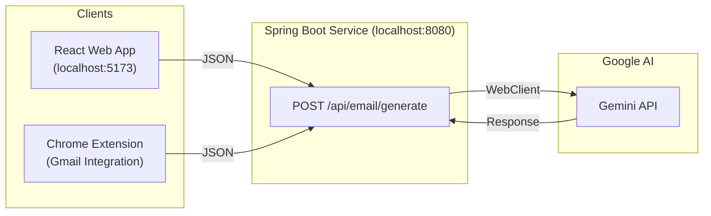

# AI Email Assistant

An AI-powered email reply generator powered by **Google Gemini**. The project comprises three components: a **Spring Boot REST API**, a **React web interface**, and a **Chrome extension for Gmail**.

---

## Architecture Overview



---

## Project Structure

```text
email-writer/
├── email-writer-sb/       # Spring Boot backend (REST API & Gemini integration)
├── email-writer-react/    # React + Vite web dashboard
└── email-writer-ext/      # Chrome extension (Manifest V3 for Gmail)
```

---

## Prerequisites

- **Java 21+**
- **Node.js 18+** & npm
- **Google Gemini API Key** (from [Google AI Studio](https://aistudio.google.com/))
- **Google Chrome** (for testing the extension)

---

## Configuration & Environment Variables

The backend requires the following environment variables to communicate with Gemini:

| Variable | Description | Example / Recommended Value |
| :--- | :--- | :--- |
| `GEMINI_URL` | Gemini `generateContent` endpoint URL (must end with `?key=`) | `https://generativelanguage.googleapis.com/v1beta/models/gemini-1.5-flash:generateContent?key=` |
| `GEMINI_KEY` | Your Gemini API Key | `AIzaSy...` |

> **Note**: `EmailGeneratorService` builds the request URI as `geminiApiUrl + geminiApiKey`. Ensure `GEMINI_URL` includes the trailing `?key=`.

Alternatively, configure them directly in `email-writer-sb/src/main/resources/application.properties`:
```properties
gemini.api.url=https://generativelanguage.googleapis.com/v1beta/models/gemini-1.5-flash:generateContent?key=
gemini.api.key=YOUR_API_KEY
```

---

## Setup & Running

### 1. Backend (`email-writer-sb`)

1. Open a terminal in `email-writer-sb`:
   ```bash
   cd email-writer-sb
   ```

2. Set environment variables:

   **Windows (PowerShell):**
   ```powershell
   $env:GEMINI_URL="https://generativelanguage.googleapis.com/v1beta/models/gemini-1.5-flash:generateContent?key="
   $env:GEMINI_KEY="YOUR_API_KEY"
   ```

   **Windows (CMD):**
   ```cmd
   set GEMINI_URL=https://generativelanguage.googleapis.com/v1beta/models/gemini-1.5-flash:generateContent?key=
   set GEMINI_KEY=YOUR_API_KEY
   ```

   **Linux / macOS:**
   ```bash
   export GEMINI_URL="https://generativelanguage.googleapis.com/v1beta/models/gemini-1.5-flash:generateContent?key="
   export GEMINI_KEY="YOUR_API_KEY"
   ```

3. Run the application:
   ```bash
   # Windows
   .\mvnw.cmd spring-boot:run

   # Linux / macOS
   ./mvnw spring-boot:run
   ```
   Backend runs at: `http://localhost:8080`

---

### 2. Frontend (`email-writer-react`)

1. Open a terminal in `email-writer-react`:
   ```bash
   cd email-writer-react
   ```

2. Install dependencies:
   ```bash
   npm install
   ```

3. Start development server:
   ```bash
   npm run dev
   ```
   Web app runs at: `http://localhost:5173`

---

### 3. Chrome Extension (`email-writer-ext`)

1. Open Chrome and go to `chrome://extensions/`.
2. Enable **Developer mode** (top-right toggle).
3. Click **Load unpacked** (top-left button).
4. Select the `email-writer-ext` folder from this repository.
5. Open [Gmail](https://mail.google.com).
6. Open any email thread and click **Reply** (or **Compose**).
7. The **AI Reply** button will appear in the compose toolbar. Clicking it extracts the email thread, requests a reply from `http://localhost:8080/api/email/generate`, and inserts the generated text into the compose box.

---

## API Reference

### `POST /api/email/generate`

Generates an email reply based on the provided email body and optional tone.

#### Request

- **Headers**: `Content-Type: application/json`
- **Body**:
  ```json
  {
    "emailContent": "Hi, could you send me the project report by tomorrow afternoon?",
    "tone": "professional"
  }
  ```

| Parameter | Type | Required | Description |
| :--- | :--- | :--- | :--- |
| `emailContent` | `string` | Yes | The email content to reply to |
| `tone` | `string` | No | Tone of the reply (`professional`, `casual`, `friendly`, or `""` for natural) |

#### Response

- **Status**: `200 OK`
- **Content-Type**: `text/plain`
- **Body**: Text response containing the drafted email reply (without subject line).
